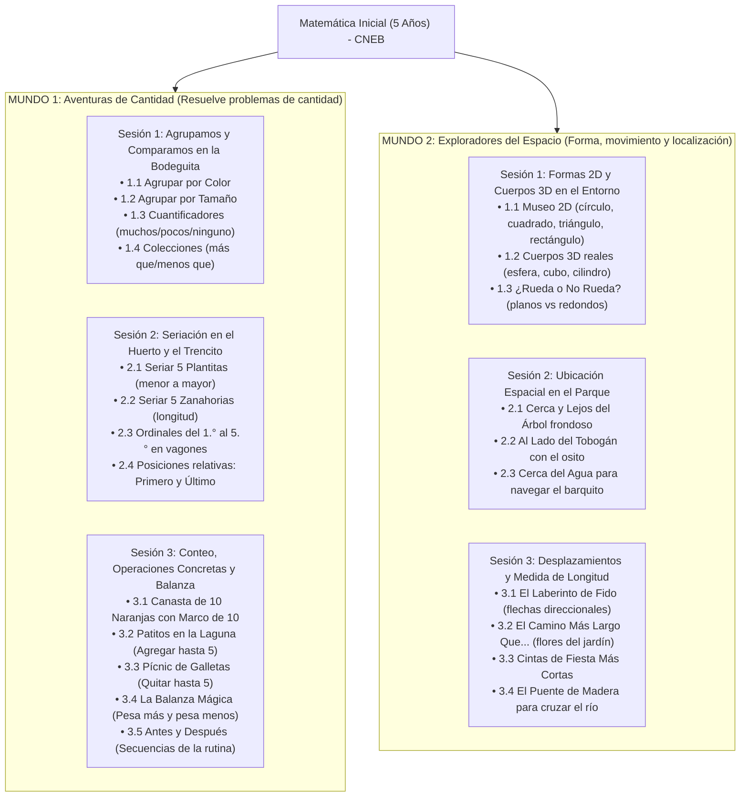

# Documentación Técnica y Pedagógica: Sistema EdTech de Matemática Inicial (5 Años) - CNEB Perú

**Marco Normativo:** Currículo Nacional de la Educación Básica (CNEB) - Ciclo II (5 Años) - Nivel 2 de Aprendizaje  
**Resolución de Referencia:** RVM N° 094-2020-MINEDU (Norma Técnica que Regula la Evaluación de las Competencias de los Estudiantes)  
**Público Objetivo:** Niños y niñas de 5 años (etapa prelectora), docentes de Educación Inicial y familias.  

---

## 1. Arquitectura General del Sistema

La aplicación es una **Single Page Application (SPA) 100% autocontenida y modular** que no requiere servidores externos, instalación de Node/Python ni procesos de compilación. Funciona de manera inmediata abriendo el archivo `index.html` en cualquier navegador web moderno (Edge, Chrome, Safari, tablets o pizarras interactivas táctiles).

### Mapa del Proyecto

```
Aplicacion Inicial/
├── index.html                           # Estructura principal, fuentes Google Fonts y carga de módulos
├── css/
│   └── styles.css                       # Sistema visual UX/UI, botones 3D (>64px), animaciones y fallback offline
├── js/
│   ├── audio.js                         # Web Audio API (sintetizador de sonido puro) + Web Speech API
│   ├── confetti.js                      # Motor de física de confeti festivo y estrellas en Canvas nativo
│   ├── data.js                          # Malla curricular del CNEB: 2 Mundos, 6 Sesiones y rúbricas oficiales
│   ├── state.js                         # Gestor de progreso, intentos, pistas, escala AD/A/B/C y SIAGIE
│   ├── mascot.js                        # Mascota Kusi la Vicuñita (SVG animado, boca móvil y burbuja)
│   ├── docente.js                       # Panel formativo para docentes con filtro Parental Gate
│   ├── app.js                           # Enrutador principal y despacho dinámico de los 23 juegos
│   └── games/
│       ├── cantidad-agrupacion.js       # Mundo 1 - Sesión 1: 4 juegos de agrupación y cuantificadores
│       ├── cantidad-seriacion.js        # Mundo 1 - Sesión 2: 4 juegos de seriación y ordinales (1.° al 5.°)
│       ├── cantidad-conteo.js           # Mundo 1 - Sesión 3: Juego 3.1 conteo hasta 10 con Marco de Diez
│       ├── cantidad-operaciones.js      # Mundo 1 - Sesión 3: Juegos 3.2 y 3.3 agregar y quitar hasta 5
│       ├── cantidad-peso-tiempo.js      # Mundo 1 - Sesión 3: Juegos 3.4 y 3.5 balanza mágica y tiempo
│       ├── espacio-formas.js            # Mundo 2 - Sesión 1: 3 juegos de formas 2D, cuerpos 3D y rodar
│       ├── espacio-ubicacion.js         # Mundo 2 - Sesión 2: 3 juegos de ubicación espacial (cerca, lejos, al lado)
│       ├── espacio-desplazamiento.js    # Mundo 2 - Sesión 3: Juego 3.1 cuadrícula con flechas direccionales
│       └── espacio-longitud.js          # Mundo 2 - Sesión 3: Juegos 3.2, 3.3 y 3.4 comparación de longitud
└── DOCUMENTACION_SISTEMA_EDTECH_CNEB.md # Esta documentación técnica y pedagógica integral
```

---

## 2. Enfoque Pedagógico del CNEB y Experiencia de Usuario (UX/UI)

### 2.1 Cero Dependencia de Lectura (Etapa Prelectora)
- **Síntesis de Voz Asistida (`window.speechSynthesis`)**: Cada reto, retroalimentación y transición es narrada en español con modulación infantil, afectiva y pausada (`rate: 0.92`, `pitch: 1.18`).
- **Botón Parlante Pulsante**: Siempre visible junto a Kusi para que el niño pueda repetir la instrucción oral tantas veces como desee con total autonomía.
- **Sintetizador Web Audio API Puro**: Efectos sintetizados en código matemático (ondas senoidales y triangulares) que garantizan que el sonido y la música de conteo funcionen 100% offline sin fallos de red.

### 2.2 Pedagogía del Error Constructivo (Sin Frustración)
- En estricto cumplimiento del CNEB: **"Aprender del error"**:
  - No existen pantallas de *"Perdiste"*, sonidos agresivos de "buzzer" ni cruces rojas.
  - Si el niño ensaya una opción diferente, la mascota Kusi realiza un gesto reflexivo, emite un tono cálido y le brinda una **pista de mediación** adaptada.
  - Al segundo ensayo, la opción objetivo resalta con un halo pulsante (`pulse-target`).

### 2.3 Ergonomía Táctil Adaptada
- Botones grandes (mínimo 64x64px hasta 110px de ancho).
- Estilo táctil **Chunky 3D** con bisel que da retroalimentación física visual al toque.

---

## 3. Malla Curricular Integral: 2 Mundos y 6 Sesiones Pedagógicas



---

## 4. Detalle de los 23 Retos Interactivos

### MUNDO 1: Aventuras de Cantidad (13 Retos)
1. **Sesión 1: Agrupamos y Comparamos en la Bodeguita de Don Lucho**
   - *1.1 Agrupar por Color*: Clasificar 6 frutas en canastas roja, amarilla y verde.
   - *1.2 Agrupar por Tamaño*: Clasificar objetos grandes en caja grande y pequeños en caja pequeña.
   - *1.3 Cuantificadores*: Discriminar la canasta donde *no hay ninguna* fruta (vacía).
   - *1.4 Comparar Colecciones*: Reconocer el plato donde hay *más fresas que* en el otro.
2. **Sesión 2: Seriación en el Huerto y el Trencito de los Ordinales**
   - *2.1 Seriar 5 Plantitas*: De la semilla al árbol frondoso (1.° al 5.° puesto).
   - *2.2 Seriar 5 Zanahorias*: De la más corta a la más larga para el conejo.
   - *2.3 Ordinales del 1.° al 5.°*: Identificar qué animalito viaja en el 4.° vagón del trencito.
   - *2.4 Primero y Último*: Reconocer quién está primero junto a la puerta y quién está último.
3. **Sesión 3: Conteo, Operaciones Concretas y Balanza**
   - *3.1 Canasta de 10 Naranjas*: Conteo oral biunívoco 1 al 10 y llenado del *Marco de Diez*.
   - *3.2 Agregar Patitos*: 2 patitos en la laguna + 1 que llega = 3 patitos.
   - *3.3 Quitar Galletitas*: 4 galletas en el plato - 1 comida por el monito = 3 galletas.
   - *3.4 Balanza Mágica*: Brazo basculante interactivo (la sandía *pesa más* e inclina la balanza).
   - *3.5 Antes y Después*: Rutina diaria (despertar y asearse).

### MUNDO 2: Exploradores del Espacio (10 Retos)
1. **Sesión 1: Formas 2D y Cuerpos 3D en el Entorno**
   - *1.1 Museo 2D*: Reconocer objetos circulares en el entorno (moneda de sol).
   - *1.2 Cuerpos 3D*: Identificar cuerpos cilíndricos en la vida real (lata de leche/conserva).
   - *1.3 ¿Rueda o No Rueda?*: Discriminar objetos redondos que ruedan (esfera) de los planos (caja).
2. **Sesión 2: Ubicación Espacial en el Parque**
   - *2.1 Cerca y Lejos*: Poner la pelota *cerca del árbol* vs lejos junto a la casita.
   - *2.2 Al Lado de*: Sentar al osito *al lado del tobogán*.
   - *2.3 Cerca del Agua*: Colocar el barquito *cerca de la orilla de la laguna*.
3. **Sesión 3: Desplazamientos y Medida de Longitud**
   - *3.1 El Laberinto de Fido*: Cuadrícula 4x4 interactiva con flechas táctiles gigantes (*adelante*, *atrás*, *a un lado*, *al otro lado*).
   - *3.2 Más Largo Que*: Comparar dos caminos con baldosas y flores para elegir el más largo.
   - *3.3 Más Corto Que*: Identificar la cinta festiva más corta.
   - *3.4 El Puente de Madera*: Elegir la tabla más larga para que Kusi pueda cruzar el río a salvo.

---

## 5. Módulo de Evaluación Formativa Docente y SIAGIE

### 5.1 Control de Acceso Parental (Parental Gate)
El botón `🔒 Zona Docente` formula una suma aritmética aleatoria para adultos (ej. `6 + 7 = ?`) protegiendo el acceso a la evaluación pedagógica.

### 5.2 Escala de Calificación CNEB (RVM N° 094-2020-MINEDU)
- **AD (Logro Destacado)**: Resuelve el reto en su primer intento con total autonomía y sin pistas.
- **A (Logro Esperado)**: Resuelve satisfactoriamente en 1 o 2 intentos de forma autónoma.
- **B (En Proceso)**: Resuelve el reto tras recibir pistas amigables de Kusi (aprende del error).
- **C (En Inicio)**: Muestra dificultades frecuentes o requiere mediación directa del adulto.

### 5.3 Conclusiones Descriptivas Oficiales
El sistema genera automáticamente la redacción técnica pedagógica para **ambas competencias**, lista para ser transcrita a las libretas o al sistema **SIAGIE**, detallando logros observados y recomendaciones prácticas para el hogar.

### 5.4 Impresión de Reportes y Exportación a PDF Oficial
El sistema cuenta con un motor de estilos de impresión `@media print` especialmente calibrado para páginas A4:
- **Membrete Oficial Institucional**: Encabezado formal de Educación Inicial con fecha y año lectivo.
- **Cero Solapamientos**: Se eliminaron posicionamientos absolutos y desbordamientos en scroll para garantizar una paginación natural de varias páginas.
- **Formateo de Conclusiones**: Los textos de conclusiones descriptivas son procesados mediante un convertidor Markdown-to-HTML que resalta en negrita semántica los logros y recomendaciones.
- **Ficha de Datos Limpia**: En pantalla permite editar interactivamente el nombre del estudiante y en el PDF se imprime en tipografía ejecutiva limpia sin cajas de entrada.
- **Bloque de Firmas**: Incluye tres campos de rúbrica oficial (Docente de Aula, Dirección de la I.E. Inicial y Padre/Madre/Apoderado).

---

## 6. Instrucciones de Uso

1. Abra el archivo `index.html` en su navegador web favorito.
2. Elija entre **Aventuras de Cantidad** o **Exploradores del Espacio**.
3. Seleccione cualquiera de las **6 Sesiones Pedagógicas** y disfrute de los retos interactivos.
4. Para consultar las calificaciones y el informe de evaluación formativa, presione el botón `Zona Docente` en la esquina superior.
