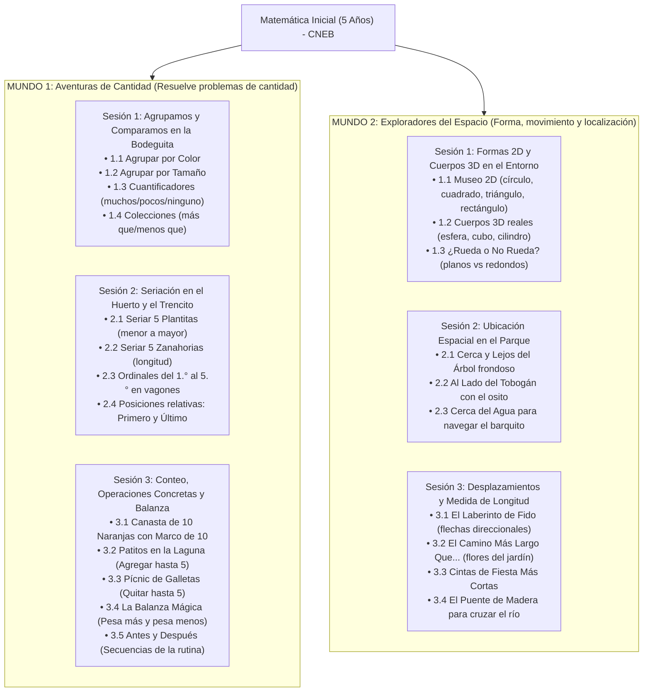

# Documentación Técnica y Pedagógica: Sistema EdTech de Matemática Inicial (5 Años) - CNEB Perú

**Marco Normativo:** Currículo Nacional de la Educación Básica (CNEB) - Ciclo II (5 Años) - Nivel 2 de Aprendizaje  
**Resolución de Referencia:** RVM N° 094-2020-MINEDU (Norma Técnica que Regula la Evaluación de las Competencias de los Estudiantes)  
**Público Objetivo:** Niños y niñas de 5 años (etapa prelectora), docentes de Educación Inicial y familias.  

---

## 1. Arquitectura General del Sistema

La aplicación es una **Single Page Application (SPA) 100% modular y autocontenida** que combina ejecución en cliente con sincronización en tiempo real en la nube a través de **Supabase**. Puede funcionar de manera inmediata abriendo `index.html` sin necesidad de Node.js o servidores locales, y cuenta con soporte *Offline-First* con persistencia transparente en `localStorage`.

### Mapa del Proyecto y Módulos

```
Aplicacion Inicial/
├── index.html                           # Estructura principal, fuentes Google Fonts, Tailwind CDN y carga de scripts
├── supabase_schema.sql                  # Definición de tablas PostgreSQL, claves foráneas y políticas RLS
├── css/
│   └── styles.css                       # Sistema visual UX/UI, botones 3D (>64px), animaciones y reglas de impresión
├── js/
│   ├── audio.js                         # Web Audio API (sintetizador de sonido puro) + Web Speech API (voz en español)
│   ├── confetti.js                      # Motor de física de confeti festivo y estrellas en Canvas nativo
│   ├── data.js                          # Malla curricular del CNEB: 2 Mundos, 6 Sesiones y rúbricas oficiales AD/A/B/C
│   ├── state.js                         # Gestor de progreso, intentos, pistas, escala cualitativa y redacción SIAGIE
│   ├── mascot.js                        # Mascota Kusi animada en SVG, boca sincronizada con voz y burbuja de diálogo
│   ├── dragdrop.js                      # Motor Pointer Events API para arrastre y soltado físico táctil
│   ├── students.js                      # Gestión de perfiles infantiles, catálogo de 30+ avatares y buscador en vivo
│   ├── auth.js                          # Autenticación, roles (Docente/Familias), auto-login por URL e impersonation
│   ├── supabase-config.js               # Conexión, sincronización en tiempo real y fallback offline a LocalStorage
│   ├── familia.js                       # Portal familiar privado, medallero, pautas para casa y diploma oficial
│   ├── docente.js                       # Panel integral docente: sábana de monitoreo, SIAGIE, accesos y personalización
│   ├── app.js                           # Enrutador principal y despacho dinámico de los 23 minijuegos
│   └── games/
│       ├── cantidad-agrupacion.js       # Mundo 1 - Sesión 1: 4 juegos de agrupación y cuantificadores
│       ├── cantidad-seriacion.js        # Mundo 1 - Sesión 2: 4 juegos de seriación y ordinales (1.° al 5.°)
│       ├── cantidad-conteo.js           # Mundo 1 - Sesión 3: Juego 3.1 conteo hasta 10 con Marco de Diez
│       ├── cantidad-operaciones.js      # Mundo 1 - Sesión 3: Juegos 3.2 y 3.3 agregar y quitar hasta 5
│       ├── cantidad-peso-tiempo.js      # Mundo 1 - Sesión 3: Juegos 3.4 y 3.5 balanza mágica y secuencias
│       ├── espacio-formas.js            # Mundo 2 - Sesión 1: 3 juegos de formas 2D, cuerpos 3D y rodar
│       ├── espacio-ubicacion.js         # Mundo 2 - Sesión 2: 3 juegos de ubicación espacial (cerca, lejos, al lado)
│       ├── espacio-desplazamiento.js    # Mundo 2 - Sesión 3: Juego 3.1 cuadrícula con flechas direccionales
│       └── espacio-longitud.js          # Mundo 2 - Sesión 3: Juegos 3.2, 3.3 y 3.4 comparación de longitud
├── README.md                            # Guía rápida y resumen general para GitHub
└── DOCUMENTACION_SISTEMA_EDTECH_CNEB.md # Esta documentación técnica y pedagógica integral
```

---

## 2. Enfoque Pedagógico del CNEB y Experiencia de Usuario (UX/UI)

### 2.1 Cero Dependencia de Lectura (Etapa Prelectora)
- **Síntesis de Voz Asistida (`window.speechSynthesis`)**: Cada reto, retroalimentación y transición es narrada en español con modulación infantil, afectiva y pausada (`rate: 0.92`, `pitch: 1.18`).
- **Botón Parlante Pulsante**: Siempre visible junto a la mascota para que el niño pueda repetir la instrucción oral tantas veces como desee con total autonomía.
- **Sintetizador Web Audio API Puro**: Efectos sintetizados en código matemático (ondas senoidales y armónicos) que garantizan que el sonido y los tonos de conteo funcionen 100% offline sin fallos de red.

### 2.2 Pedagogía del Error Constructivo (Sin Frustración)
- En estricto cumplimiento del principio del CNEB: **"Aprender del error"**:
  - No existen pantallas de *"Perdiste"*, sonidos agresivos de "buzzer" ni cruces rojas descalificatorias.
  - Si el niño ensaya una opción diferente, la mascota Kusi realiza un gesto reflexivo, emite un tono cálido y le brinda una **pista de mediación** adaptada.
  - Al segundo ensayo, la opción objetivo resalta con un halo pulsante sutil (`pulse-target`).

### 2.3 Ergonomía Táctil Adaptada
- Botones táctiles grandes (mínimo 64x64px hasta 110px de ancho).
- Estilo táctil **Chunky 3D** con bisel que da retroalimentación física visual al toque.
- Arrastre físico real (*Physics Drag & Drop*) mediante la Pointer Events API que estimula la coordinación visomotriz y la psicomotricidad fina.

---

## 3. Malla Curricular Integral: 2 Mundos y 6 Sesiones Pedagógicas



---

## 4. Detalle de los 23 Retos Interactivos

### MUNDO 1: Aventuras de Cantidad (13 Retos)
1. **Sesión 1: Agrupamos y Comparamos en la Bodeguita de Don Lucho**
   - *1.1 Agrupar por Color*: Arrastre táctil a canastas roja, amarilla y verde.
   - *1.2 Agrupar por Tamaño*: Clasificación en caja grande y caja pequeña.
   - *1.3 Cuantificadores*: Discriminar colecciones con *"muchos"*, *"pocos"* o *"ninguno"*.
   - *1.4 Comparar Colecciones*: Reconocer dónde hay *"más que"* o *"menos que"*.
2. **Sesión 2: Seriación en el Huerto y el Trencito de los Ordinales**
   - *2.1 Seriar 5 Plantitas*: De la semilla germinada al árbol frondoso (1.° al 5.° puesto).
   - *2.2 Seriar 5 Zanahorias*: De la más corta a la más larga para el conejito.
   - *2.3 Ordinales del 1.° al 5.°*: Identificar qué animal viaja en un vagón ordinal determinado.
   - *2.4 Primero y Último*: Discriminar posiciones relativas en la fila.
3. **Sesión 3: Conteo, Operaciones Concretas y Balanza**
   - *3.1 Canasta de 10 Naranjas*: Conteo oral biunívoco 1 al 10 y llenado del *Marco de Diez*.
   - *3.2 Agregar Patitos*: Situación aditiva vivencial agregando hasta 5 elementos.
   - *3.3 Quitar Galletitas*: Situación sustractiva vivencial quitando hasta 5 elementos.
   - *3.4 Balanza Mágica*: Balanza interactiva basculante (*pesa más* / *pesa menos*).
   - *3.5 Antes y Después*: Secuencia temporal de la rutina cotidiana.

### MUNDO 2: Exploradores del Espacio (10 Retos)
1. **Sesión 1: Formas 2D y Cuerpos 3D en el Entorno**
   - *1.1 Museo 2D*: Círculo, cuadrado, triángulo y rectángulo en objetos de la vida real.
   - *1.2 Cuerpos 3D*: Reconocer esfera, cubo y cilindro en el entorno cotidiano.
   - *1.3 ¿Rueda o No Rueda?*: Discriminar cuerpos redondos de figuras planas.
2. **Sesión 2: Ubicación Espacial en el Parque**
   - *2.1 Cerca y Lejos*: Poner la pelota *cerca del árbol* vs *lejos del árbol*.
   - *2.2 Al Lado de*: Sentar al osito de peluche *al lado del tobogán*.
   - *2.3 Cerca del Agua*: Colocar el barquito *cerca de la orilla de la laguna*.
3. **Sesión 3: Desplazamientos y Medida de Longitud**
   - *3.1 El Laberinto de Fido*: Cuadrícula 4x4 guiada por flechas direccionales táctiles.
   - *3.2 Más Largo Que*: Comparación perceptual de caminos con flores.
   - *3.3 Más Corto Que*: Identificación de la cinta festiva más corta.
   - *3.4 El Puente de Madera*: Elegir la tabla de madera más larga para cruzar el río a salvo.

---

## 5. Módulo de Autenticación, Roles y Seguridad (`auth.js`)

- **Control de Roles:**
  - **Docente:** Acceso mediante PIN maestro de seguridad configurable (por defecto `1234`).
  - **Estudiantes y Familias:** Acceso mediante Código de Estudiante (`[Letra del Apellido] + [4 dígitos]`, ej. `V4821`) y PIN personalizado.
- **Acceso Rápido por URL (Auto-Login):** Enlace directo con parámetros (`?id=V4821&pin=V4821`) para iniciar sesión en celulares y tablets al tocar un enlace en WhatsApp sin escribir credenciales.
- **Modo Suplantación (*Impersonate*):** La docente puede acceder al entorno de cualquier estudiante desde el panel para revisar sus avances de forma directa.

---

## 6. Sincronización en la Nube con Supabase (`supabase-config.js`)

- **Persistencia Híbrida Cloud + Offline First:**
  - En modo offline utiliza `localStorage` con resguardo total de partidas y estrellas.
  * Al contar con conexión a internet, se conecta a **Supabase (PostgreSQL)** mediante el cliente oficial v2.
- **Modelo Relacional (`supabase_schema.sql`):**
  - `colegio_config`: Personalización institucional, mascota, logotipos, nombres de docentes y firmas oficiales.
  - `usuarios`: Registros de docentes y apoderados con roles e información de contacto.
  - `estudiantes`: Nómina oficial de alumnos con estrellas, avatar y fecha de última actividad.
  - `evaluaciones`: Registro formativo detallado por juego (intentos, aciertos, pistas, estado y calificación cualitativa).
- **Políticas RLS:** Políticas de acceso seguras para clave pública anónima (*anon key*).

---

## 7. Panel Docente de Gestión Integral (`docente.js`)

Protegido por PIN, incluye 4 áreas operativas:

1. **Monitoreo del Aula:** Sábana grupal con KPIs en vivo, podio de honor de los 3 estudiantes más destacados, semáforo de actividad, exportación a Excel (CSV) y sincronización de reportes recibidos.
2. **Ficha Individual CNEB:** Informe oficial por estudiante con desglose cualitativo (AD, A, B, C) e informe técnico con **conclusiones descriptivas automáticas oficiales para el SIAGIE** listas para imprimir en PDF.
3. **Familias y Accesos:** Registro de nuevos alumnos, envío de credenciales por **WhatsApp y Correo Electrónico**, restablecimiento de claves y modo suplantación.
4. **Colegio y Mascota:** Catálogo de más de 30 mascotas (fauna andina y peruana), datos del colegio, aula, docente y **personalizador de diplomas oficiales con logo y firmas digitales**.

---

## 8. Portal para Familias y Diplomas de Logro (`familia.js`)

- **Privacidad Total:** La familia visualiza únicamente los logros de su hijo.
- **Botón de Reporte WhatsApp:** Envía el avance y estrellas del niño directamente al WhatsApp de la profesora.
- **Medallero Gamificado:** 6 medallas desbloqueables según el avance en las sesiones.
- **Pautas Formativas para Casa:** Recomendaciones cotidianas para reforzar la matemática en el hogar.
- **Diploma Oficial Desbloqueable:** Se activa al completar los 23 retos pedagógicos con sellos, firmas de dirección/docente y membrete institucional.

---

## 9. Escala de Calificación CNEB (RVM N° 094-2020-MINEDU)

| Calificación | Denominación Oficial | Criterio Pedagógico Automatizado en el Sistema |
| :---: | :--- | :--- |
| **AD** | **Logro Destacado** | Resuelve el reto en su primer intento con total autonomía y sin pistas. |
| **A** | **Logro Esperado** | Resuelve satisfactoriamente en 1 o 2 intentos de forma autónoma. |
| **B** | **En Proceso** | Resuelve el reto tras recibir pistas reflexivas de la mascota (aprende del error). |
| **C** | **En Inicio** | Presenta dificultades reiteradas o requiere acompañamiento directo del adulto. |
