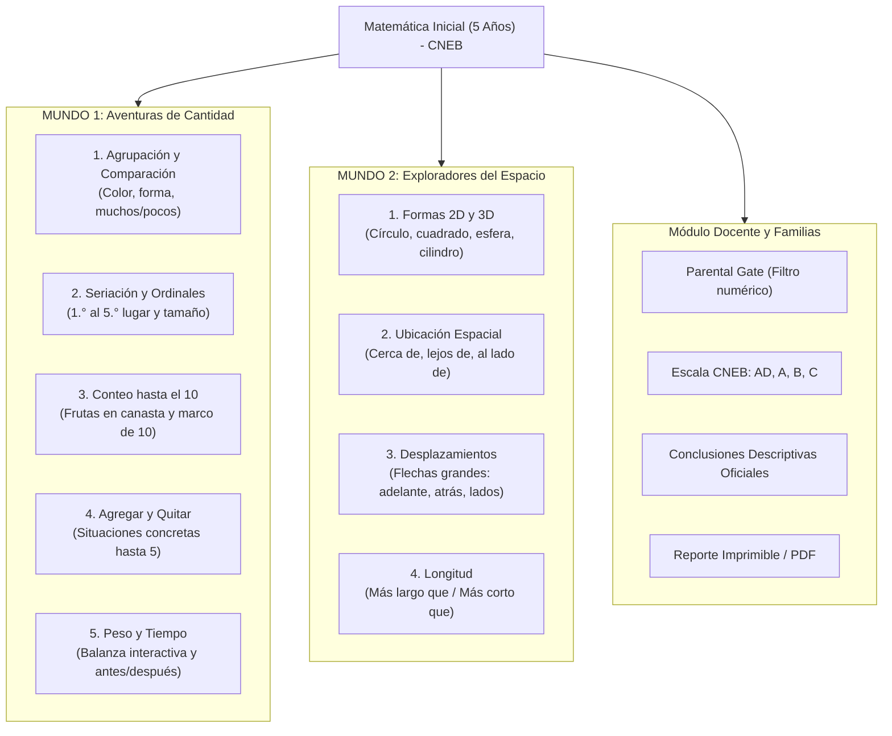

# Guía Pedagógica y Técnica: Matemática Inicial (5 Años) - CNEB Perú

Esta aplicación web interactiva y gamificada ha sido diseñada y desarrollada específicamente para niños y niñas de **5 años (Ciclo II - Nivel 2)**, cumpliendo con las orientaciones pedagógicas del **Currículo Nacional de la Educación Básica (CNEB)** del Perú (RVM N° 094-2020-MINEDU).

---

## 1. Fundamentación Pedagógica y Principios del CNEB

### A. Partir de Situaciones Significativas
Los desafíos matemáticos están contextualizados en escenarios cotidianos peruanos y familiares para el niño:
- **"La Bodeguita de Don Lucho"**: Agrupación de frutas y comparación de cantidades.
- **"El Huerto y el Trencito de la Granja"**: Seriación de plantas y ordinales con animalitos.
- **"La Laguna de los Patitos"**: Adición y sustracción mediante manipulación concreta.
- **"El Parque de Juegos"**: Orientación espacial (cerca/lejos, al lado) y trayectorias.

### B. El Error Constructivo (Sin Castigo ni Pantallas de Frustración)
- **Cero cruces rojas ni avisos de "Perdiste"**: Un niño de 5 años construye hipótesis. Si escoge una opción distinta, la mascota amigable **Kusi** realiza un gesto reflexivo, reproduce un sonido suave y brinda una pista auditiva y visual inmediata:
  > *"¡Buen intento! Observa con atención: esta canasta necesita objetos redonditos como una moneda. ¡Vamos, tú puedes!"*
- A los intentos reiterados, el elemento objetivo resalta con un brillo pulsante para guiar su atención.

### C. Cero Dependencia de Lectura (Etapa Prelectora)
- **Síntesis de voz automática (`window.speechSynthesis`)**: La aplicación le habla al niño en español peruano en cada pantalla y reto.
- **Botón de megáfono / parlante gigante**: Siempre visible junto a Kusi para que el niño pueda repetir la instrucción cuantas veces lo necesite de forma autónoma.
- **Sintetizador Web Audio API puro**: Efectos de xilófono para el conteo musical ascendente (1 al 10), fanfarria de confeti y arpegios de éxito sin riesgo de desconexión de red.

---

## 2. Mapa Curricular de Minijuegos (Ciclo II - Nivel 2)

---

## 3. Matriz de Evaluación Formativa y Escala CNEB

El módulo de **Zona Docente** (ubicado discretamente en la esquina superior y protegido por un reto numérico para adultos) procesa el desempeño del estudiante según los lineamientos de la **RVM N° 094-2020-MINEDU**:

| Escala | Nivel CNEB | Criterio Pedagógico en la App |
| :---: | :--- | :--- |
| **AD** | **Logro Destacado** | Resuelve los retos a la primera intención con alta autonomía y seguridad. |
| **A** | **Logro Esperado** | Cumple satisfactoriamente las actividades en 1 o 2 intentos de manera autónoma. |
| **B** | **En Proceso** | Logra resolver el desafío tras escuchar y reflexionar con las pistas amigables de Kusi. |
| **C** | **En Inicio** | Muestra dificultades reiteradas y requiere el acompañamiento directo del adulto o mediador. |

### Conclusiones Descriptivas Automáticas
El sistema genera automáticamente el texto formal listo para consignar en las libretas de información y en el **SIAGIE**:
- **Logro alcanzado**: Descripción detallada de las capacidades evidenciadas en cada competencia.
- **Recomendación pedagógica**: Orientaciones prácticas para continuar enriqueciendo el aprendizaje en el aula y con la familia en casa con material concreto.
